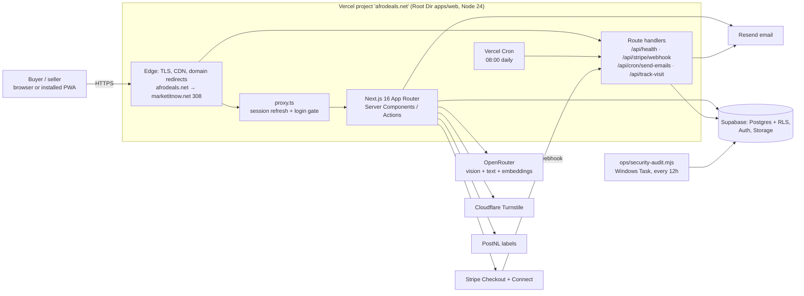
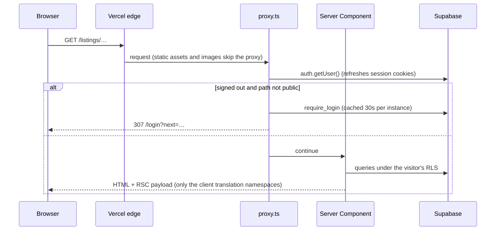
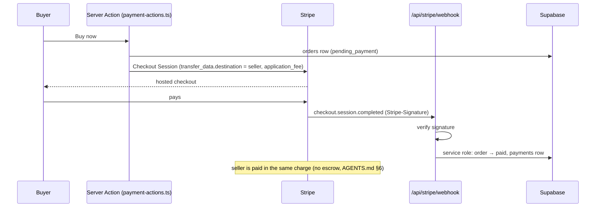

# MarketitNow — system architecture

Living document (master prompt directive 5). Update it in the same change as anything that alters
a box or an arrow below. Last verified against the code and the live site: 2026-11-06.

## 1. System context



- **One customer-facing address:** https://marketitnow.net. `lib/site-url.ts` forces it for every
  generated link in production; `afrodeals.net` only redirects. The old Plesk host
  (`marketplace.apps-pilot.nl`) is retired and must not be deployed to.
- **Trust boundary:** the browser talks to Postgres only through RLS (`anon`/`authenticated` keys).
  The service role (`lib/supabase/service.ts`) is used only by trusted server code: webhooks, cron,
  moderation, admin.

## 2. A page request



## 3. Direct Buy payment (destination charge)



## 4. Build and deploy

```mermaid
flowchart LR
  dev[Local: tsc, eslint, vitest, next build] --> push[git push github &lt;branch&gt;]
  push --> ci[GitHub Actions CI<br/>types · lint · tests · npm audit]
  push -->|branch| preview[Vercel preview deployment]
  push -->|main, owner sign-off| prod[Vercel production → marketitnow.net]
  prod --> verify[/api/health shows the commit;<br/>headers; browser checks]
```

Rollback: `vercel rollback` (or promote the previous deployment in the Vercel dashboard) from
`apps/web`; see `docs/RUNBOOK.md`.

Regions: the Supabase database is in AWS eu-west-1 (Ireland). Server functions run in Vercel
`dub1` (Dublin) next to it (`apps/web/vercel.json`, ADR-0002); static files come from Vercel's
global CDN. After a deploy, `npm run check:live` (in `apps/web`) runs the browser, accessibility,
security and load checks against production (`tests/browser/README.md`). Decisions:
`docs/adr/`.

## 5. Core data model

158 tables in total (`lib/supabase/database.types.ts`, generated from the live schema). The core of
the marketplace, with the keys that link it:

```mermaid
erDiagram
  profiles ||--o{ listings : "seller_id"
  categories ||--o{ listings : "category_id"
  listings ||--o{ listing_media : "listing_id"
  profiles ||--o{ favorites : "profile_id"
  listings ||--o{ favorites : "listing_id"
  conversations ||--o{ conversation_participants : "conversation_id"
  profiles ||--o{ conversation_participants : "profile_id"
  conversations ||--o{ messages : "conversation_id"
  profiles ||--o{ messages : "sender_id"
  listings ||--o{ orders : "listing_id"
  profiles ||--o{ orders : "buyer_id / seller_id"
  orders ||--o{ payments : "order_id"
  orders ||--o{ shipments : "order_id"
  orders ||--o{ reviews : "order_id"
  profiles ||--o{ reports : "reporter_id"
```



Conventions: UUID keys; money as `*_minor` integers plus `currency_code`; user-generated content
carries `moderation_status`; display text lives in `*_translations` tables keyed by language.

## 6. API contracts (route handlers)

| Route | Caller / auth | Request | Responses |
|---|---|---|---|
| `GET /api/health` | anyone (monitors) | none | `200 {ok:true,database:"up",version,ms}` · `503 {ok:false,database:"down",error}`; `no-store` |
| `POST /api/stripe/webhook` | Stripe, `Stripe-Signature` verified (platform + Connect secrets) | raw Stripe event | `200 {received:true}` (also for a duplicate event id, de-duplicated) · `400` missing/invalid signature · `500` transient failure, so Stripe retries |
| `GET /api/cron/send-emails` | Vercel Cron, `Authorization: Bearer $CRON_SECRET` | none | `200 {savedSearchDigests, messageReminders}` · `200 {skipped}` when `RESEND_FROM_EMAIL` is unset · `401` without the secret |
| `POST /api/track-visit` | the site's own pages | visit beacon (one per visitor per day) | always `204`; feeds admin visitor stats |

Everything else is Server Actions (form posts from the app's own pages, protected by Next's
action IDs + origin check) and RLS-scoped Supabase queries.

## 7. Code map (apps/web)

| Area | Where |
|---|---|
| Routing, pages, Server Actions | `app/` (App Router); `proxy.ts` (session + login gate) |
| Data access | `lib/supabase/{client,server,service}.ts`; generated types `lib/supabase/database.types.ts` |
| Schema, RLS, functions | `supabase/migrations/` (97 numbered migrations) |
| Payments | `lib/stripe.ts`, `lib/payments.ts`, `app/listings/payment-actions.ts`, `app/api/stripe/webhook` |
| AI | `lib/ai-providers.ts`, `lib/ai-photo-analysis.ts`, `lib/ai-text.ts`, `lib/embeddings.ts` (OpenRouter) |
| AI category choice | `lib/ai-category-pick.ts` (embedding shortlist via `match_category_by_embedding`, then a text model picks one by number; prompts and parsing in `lib/category-choice.ts`). Used by the photo analysis and by Find category on step 1 of posting |
| Email | `lib/resend.ts`, `app/api/cron/send-emails` |
| Abuse controls | `lib/turnstile.ts`, `lib/rate-limit.ts`, `lib/content-moderation.ts` |
| i18n | `messages/{en,nl,fr,ar,zh}.json`, `i18n/request.ts`, `lib/client-messages.ts` |
| Brand assets | `public/logo*.svg` (source), PNGs via `scripts/gen-brand-assets.mjs` |
| Health / ops | `app/api/health`, `lib/health-check.ts`, `ops/security-audit.mjs` |

## 8. Dependencies (production)

Next.js 16.4, React 19.2, `@supabase/ssr` + `supabase-js`, `stripe`, `next-intl`, `@base-ui/react`,
Tailwind 4, `lucide-react`. `npm audit`: 0 known vulnerabilities (2026-11-06), enforced in CI at
high/critical.
